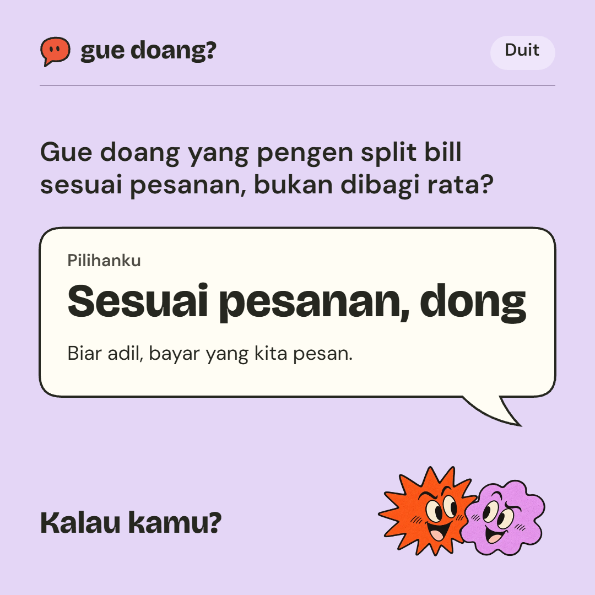

# Gue Doang?

[Gue Doang?](https://guedoang.vercel.app/) is a mobile-first public polling app for everyday dilemmas in Indonesia.

<a href="docs/share-cards/pertanyaan.png"></a>
<a href="docs/share-cards/pilihanku.png"></a>

## Run locally

Use Node.js 24 or later.

```sh
npm ci
npm run build
npm run preview
```

Open http://localhost:4174. The preview serves both the static site and the polling API. It stores data in SQLite under `.data/` and keeps it across restarts. Set `POLL_DB_PATH` for a different local file, or `PORT` to run another preview.

## How voting works

- Anyone can publish a question with two to four distinct options or open a public poll by its link. The six starter questions accept real votes.
- Votes from different browsers count toward the same totals. A random, HTTP-only cookie identifies the current browser. The database accepts one vote per browser identity and poll. Clearing cookies or using a different browser creates a new identity.
- Each visitor can see their own choice and optional reason. Other visitors receive aggregate counts. A shared poll link contains the poll ID.
- The downloadable 1080px-wide PNG includes the question before voting and the visitor’s own answer and optional reason after voting. Long content expands the canvas.
- Reporting a poll records the report and hides it from that visitor’s feed. That visitor can restore it in **Aturan & laporan**.
- Older browser-only questions and choices remain in the private device archive. To publish an archived question, open it, choose **Buat versi publik**, review the options, and submit. Historic votes and reasons stay private.

## Production

Vercel serves `dist/` and the same-origin functions in `api/`. The server connects to the project’s Neon PostgreSQL database using the server-only `DATABASE_URL` variable. Use a dedicated database. Schema initialization and starter questions are idempotent. Production never uses a temporary SQLite file as a substitute for shared storage.

## Verification

```sh
npm test
npm run build
python tests/browser_qa.py
python tests/result_card_qa.py
```

The optional browser suites use Python Playwright with Chromium. Set `PLAYWRIGHT_CHANNEL=chrome` to use installed Google Chrome. Each suite starts an isolated local server with its own disposable SQLite database. Coverage includes voting from two independent browsers, shared results, private reasons, report/restore, PNG downloads and long Unicode content.
